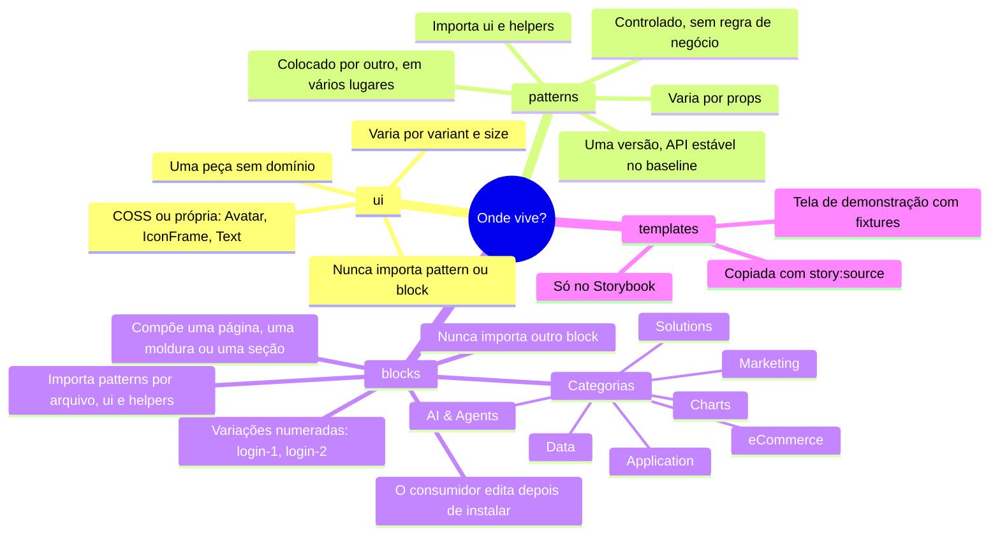
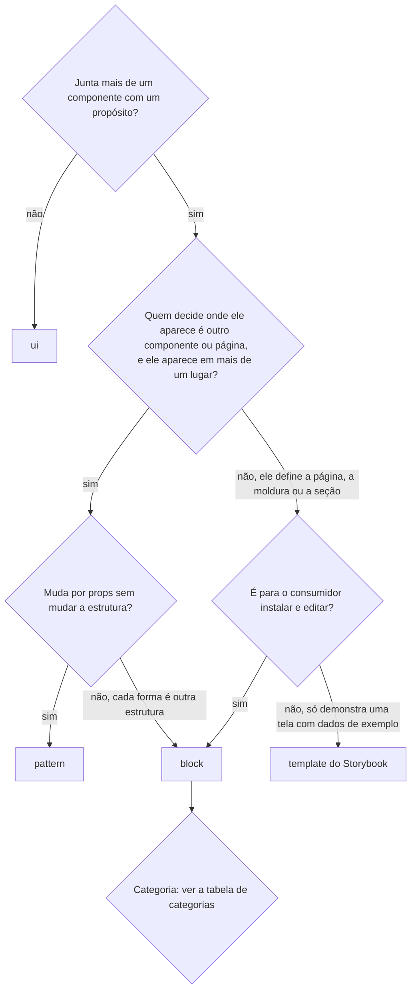

# Mapa de decisão das camadas

- **Status:** Draft; a decisão está no [ADR 0009](../../.specs/adr/0009-blocks-layer.md)
- **Date:** 2026-11-22
- **Decidido pelo dono na conversa de 2026-11-22:** `elements` deixa de existir (Avatar, IconFrame e Text vão para `ui`); app-shell e as páginas de auth são blocks; blocks vivem em categorias (Application, Data, Charts, Solutions, AI & Agents, eCommerce, Marketing); blocks consomem patterns, nunca o inverso
- **Ainda em aberto:** ver [Decisões pendentes](#decisões-pendentes)

Este arquivo responde a uma pergunta: **onde vive um pedaço de UI novo?** Primeiro escolha a camada; se for block, escolha depois a categoria.

## Camadas

```text
blocks  →  patterns  →  ui  →  utils          helpers: sem React; patterns e blocks podem importar
```

| Camada | Pacote | Alias no consumidor | Item do registry | Raiz do Storybook |
| --- | --- | --- | --- | --- |
| `ui` | `@tc96/ui` | `ui` | `registry:ui` | `UI` |
| `patterns` | `@tc96/parttens` | `patterns` | `registry:block` (só transporte) | `Patterns` |
| `blocks` | `@tc96/blocks` | `blocks` | `registry:block` | `Blocks` |
| templates | nenhum (só Storybook, ADR 0004) | nenhum | nenhum | `Templates` |

## Mapa mental



## Árvore de decisão



Regras de desempate, na ordem:

1. **Tamanho não decide.** `collection` e `wizard` são grandes e são patterns; um `login-1` é pequeno e é block.
2. **Prop ou variação?** Se a mudança pede uma prop que troca a estrutura (duas colunas em vez de uma, imagem ao lado), é uma nova variação de block. Se troca conteúdo ou comportamento, é uma prop de pattern.
3. **Dois blocks de grupos diferentes precisam da mesma peça:** ela desce para pattern (ou para `ui`, se não tiver domínio). Dentro do mesmo grupo, fica em `<grupo>/shared/`.
4. **Uma peça sem domínio** (moldura de ícone, texto, avatar) é `ui`, não pattern.
5. **Na dúvida entre pattern e block, comece como block.** Promover um block a pattern é extrair código; rebaixar um pattern a block quebra a API pública.

## Matriz de decisão

| Critério | `ui` | pattern | block | template (Storybook) |
| --- | --- | --- | --- | --- |
| Pergunta que responde | "como é esta peça?" | "como funciona este pedaço de produto?" | "como fica esta página, moldura ou seção?" | "como fica uma tela real com esses patterns?" |
| Quem decide onde aparece | quem o usa | quem o usa | o próprio block | a story |
| Instâncias | muitas por tela | uma ou mais, em várias telas | uma por rota ou por seção | uma |
| Como varia | `variant`, `size` | props, slots, compound | variações numeradas (`app-shell-1..4`) | não varia |
| Depois de instalar | o consumidor pode editar; o CLI reaproveita o arquivo dele | o consumidor usa pela API; atualiza com `--diff` | o consumidor edita livremente; é ponto de partida | não se instala |
| Contrato público | props do componente | `index.ts` no `public-api-exports.json` | `index.ts` no `public-api-exports.json` como `block:<nome>` | nenhum |
| Pode importar | `utils` | `ui`, `helpers`, outro pattern por caminho | `ui`, `helpers`, patterns por arquivo | tudo |
| Nunca importa | pattern, block | block | outro block | — |
| Estado | só de interação | só de interação | só de interação (inspector aberto, aba) | fixture |
| Textos | do consumidor | do consumidor ou `labels` | `labels` com padrão pt-BR | fixture |
| Testes | `play` no Storybook | `play` mais `bun test` em `core.ts` e `lib/` | `play` (axe) e o teste do item no registry | `play` (axe) |
| Nome no registry | nome do COSS | domínio (`record-dialog`) | grupo mais número (`login-1`) | — |
| Exemplo | `Button`, `IconFrame` | `collection`, `wizard`, `settings` | `app-shell-1`, `login-1` | `Templates/Contacts` |

## Categorias de block

Caminho: `packages/blocks/src/<categoria>/<grupo>/<block>/`. Story: `Blocks/<Categoria>/<Grupo>/<Nome>`. O nome no registry não leva a categoria e é único em todo o registry (`login-1`, não `application-login-1`).

| Categoria | Pasta | Escolha quando a tela serve para… | Grupos atuais e previstos | Patterns que costuma consumir |
| --- | --- | --- | --- | --- |
| Application | `application/` | dar moldura ou acesso ao app | `shell` (`app-shell-1..4`), `auth` (`login-1`, `signup-1`, `forgot-password-1`, `reset-password-1`, `otp-1`), `settings` (`settings-1..23`), `stats` (`stats-1..6`), `card` (`card-1..6`), `list` (`list-1..6`), `empty-state` (`empty-state-1..6`), `timeline` (`timeline-1..4`), `navbar` (`navbar-1..5`), `onboarding` (`onboarding-1..3`), `errors` | `surfaces/settings`, `surfaces/state`, `widgets` |
| Data | `data/` | ver e editar registros de qualquer domínio | `table`, `board`, `record` | `collection`, `records/*`, `properties`, `editable` |
| Charts | `charts/` | ler métricas | `dashboard`, `report` | `widgets` |
| Solutions | `solutions/` | uma vertical sem categoria própria (CRM, helpdesk) | `crm` (candidatos: `Templates/Contacts`, `DealBoard`, `ContactDetail`) | vários |
| AI & Agents | `ai-agents/` | conversar com IA ou configurar agentes e fluxos | `flow` (`workflow-editor`, `agent-builder`), `chat` | `flow/*`, `chat/*` |
| eCommerce | `ecommerce/` | catálogo, carrinho, checkout, pedidos | nenhum ainda | `collection`, `widgets` |
| Marketing | `marketing/` | páginas públicas e suas seções (hero, pricing, CTA) | nenhum ainda | poucos; quase sempre só `ui` |

Desempate de categoria, na ordem:

1. **Domínio explícito vence o genérico.** Uma tabela de pedidos é eCommerce, não Data; um chat com agente é AI & Agents, não Application.
2. **Solutions** só recebe o que pertence a uma vertical sem categoria própria. Se a tela usa o vocabulário de um domínio que já tem categoria, ela vai para essa categoria.
3. **Entre Data e Charts**, decide o conteúdo dominante: registros para Data, métricas para Charts.
4. **Application** é o que sobra para a moldura e o acesso: shell, auth, settings, erros.

## Blocks consomem patterns, nunca o inverso

Esta seção responde pela literatura e pelo mercado, não pelo projeto. O projeto aparece só no fim, como aplicação.

### O que a literatura e o mercado dizem

| Fonte | Camadas, de baixo para cima | Direção | Equivalente a block | Equivalente a pattern |
| --- | --- | --- | --- | --- |
| Atomic Design (Brad Frost, 2016) | atoms → molecules → organisms → templates → pages | cada estágio é feito do anterior | organisms de seção (header, sidebar) e templates (layout da página) | molecules e organisms reutilizáveis |
| Design System Ecosystem e Recipes (Brad Frost) | core (tokens, componentes) → recipes → smart components → produto | recipes são composições de componentes do core, com escopo de produto ou marca, e vivem fora do core | recipe: compõe o core, é específica e pode "graduar" para o core | componente do core |
| Design System Tiers (Nathan Curtis, EightShapes) | tier core → tiers de produto | o produto adota o core; o core tem a qualidade mais alta e um grupo dono | tier de produto | tier core |
| shadcn/ui | components (`registry:ui`) → blocks (`registry:block`) | o block declara os componentes em `registryDependencies` | block | component |
| COSS | primitives → particles → atoms | particles juntam primitives; atoms acrescentam integrações externas sobre particles | particle ou atom | primitive ou particle |
| Stable Dependencies Principle (Robert C. Martin) | do mais volátil para o mais estável | dependa na direção da estabilidade; o que muda muito fica em cima e depende do que muda pouco | volátil: o consumidor edita | estável: API pública |
| Acyclic Dependencies Principle (Robert C. Martin) | — | o grafo de dependências entre componentes publicados não pode ter ciclo | — | — |

### Conclusão

**Sim: block consome pattern, e o inverso é um erro em todas as fontes.** Em todos os modelos, o nível composto e específico é feito do nível genérico e reutilizável. O block é uma composição de página com escopo de produto e editável pelo consumidor, ou seja, volátil. O pattern é reutilizável e tem API, ou seja, estável. Um pattern que importasse um block violaria o SDP (dependeria de algo menos estável) e, como blocks já importam patterns, também o ADP (criaria um ciclo).

### Ressalvas da literatura

As fontes confirmam a direção, mas não confirmam tudo o que está implícito nela:

1. **Na literatura, "pattern" não fica necessariamente abaixo de block.** No GOV.UK e no Home Office, pattern é uma orientação para resolver um problema, às vezes de página inteira ("page patterns"). Nesse vocabulário, um fluxo de login seria um pattern. A regra vale pela **composição**, não pelo nome: o que é mais composto depende do que é menos composto. O tc96 usa "pattern" no sentido de componente composto e reutilizável (organism, particle), e isso precisa estar escrito, porque quem vem do GOV.UK lê diferente.
2. **A direção do import não é a direção do processo.** Frost diz que os estágios do Atomic Design não são uma sequência linear: desenha-se a página e extraem-se os organisms. Um block pode nascer antes do pattern que um dia vai consumir.
3. **A literatura prevê promoção para baixo.** Uma recipe bem-sucedida "gradua" para o core. Então a regra completa tem duas partes: o block importa o pattern, e o block reaproveitado vira pattern. Nenhuma fonte prevê o caminho contrário, de pattern para block.
4. **No SDP, a estabilidade se mede por quem depende, não pelo nome da camada.** Um pattern que ninguém usa é instável na prática. Um pedaço de block de que muitos blocks precisam já se comporta como estável e deve descer para pattern.
5. **O vocabulário varia entre fontes; a direção, não.** O COSS chama de "atoms" a camada de cima, o contrário do Atomic Design. Não vale importar o nome de uma camada de outra fonte sem conferir a posição dela.
6. **A literatura tem uma camada acima das composições:** os smart components de Frost e os atoms do COSS, que acrescentam lógica e integração com serviços. Um provider de autenticação ficaria aí. O tc96 não entrega essa camada: ela fica no consumidor, e por isso os blocks de auth são só controlados.

### Como o tc96 aplica

O `boundaries:check` impede que `parttens` importe `blocks` e que um block importe outro: um block só importa a própria pasta e o `shared/` do seu grupo (`scripts/check-boundaries.ts`). Apontamentos para a regra valer na prática:

1. **"Pode consumir" não é "deve consumir".** Um block pode usar só `ui`; os blocks de auth vão usar `form`, `field`, `otp-field` e `card`, sem nenhum pattern.
2. **Import por arquivo, não pelo barrel** (ADR 0005 D3). Pelo barrel, o item levaria todos os patterns.
3. **Lacuna: os blocks entram no interior dos patterns.** Os editores de fluxo importam `flow/canvas/composition/flow-canvas/flow-canvas`, `flow/canvas/core` e outros caminhos internos (`packages/blocks/AGENTS.md`, Dependents). Renomear um arquivo interno de um pattern quebra o block. Proposta: um block só importa o `index.ts` do pattern, o `core.ts` ou `composition/<nome>/index.ts`, e o `boundaries:check` passa a recusar os demais caminhos.
4. **A atualização de um pattern checa os blocks instalados.** Ao instalar ou atualizar um pattern, a checagem de compatibilidade do CLI compila também os arquivos `.ts` e `.tsx` da pasta de blocks do consumidor (`packages/registry/src/check-compatibility.ts`, `dependents`) e relata só os erros que a atualização causa: o que o block já tinha de errado antes não aparece. Quando o consumidor atualiza `flow-canvas`, o `agent-builder` que ele já tem é compilado junto.
5. **Block não importa block,** nem dentro da mesma categoria. Peças do grupo ficam em `<grupo>/shared/`; peças entre grupos descem para pattern.
6. **Um pattern não sabe que blocks existem:** nenhum slot, default ou label pensado para um block específico. Se um pattern precisa de algo que só um block tem, isso desce para o pattern ou para `ui`.
7. **O block segue o contrato dos patterns:** é controlado e não faz fetch, não guarda sessão, não lê cookie, não aplica tema. No auth, isso quer dizer `onSubmit(values)`, `pending`, `error` e `renderLink`, sem provider de autenticação dentro do block.

## Decisões pendentes

| # | Decisão | Recomendação | Alternativa |
| --- | --- | --- | --- |
| 1 | Raiz `Templates` do Storybook | manter, só com telas de demonstração, até elas virarem blocks de Solutions | renomear para `Screens` |
| 2 | Página de Marketing feita de seções | a página copia as seções que usa (block não importa block) | permitir que um block de página importe blocks de seção da mesma categoria |
| 3 | Lacuna 3: blocks importando o interior dos patterns | o `boundaries:check` aceita só `index.ts`, `core.ts` e `composition/<nome>/index.ts` | ficar como está |

Já decidido no ADR 0009: os editores de fluxo são blocks de `ai-agents/flow/`. Já feito na remoção de `elements`: os patterns dimensionam o Avatar do COSS por `--avatar-size`. Já feito no refactor do CLI: o alias é `blocks`, e quem ainda usa `aliases.templates`, o caminho `templates` do tsconfig ou `elements` recebe um aviso e continua funcionando.

## Fontes

- Brad Frost, *Atomic Design*, cap. 2: <https://atomicdesign.bradfrost.com/chapter-2/>
- Brad Frost, *The Design System Ecosystem*: <https://bradfrost.com/blog/post/the-design-system-ecosystem/>
- Brad Frost, *The Art of Design System Recipes*: <https://bradfrost.com/blog/post/the-art-of-design-system-recipes/>
- Brad Frost, *Design system components, recipes, and snowflakes*: <https://bradfrost.com/blog/post/design-system-components-recipes-and-snowflakes/>
- Nathan Curtis, *Design System Tiers*: <https://medium.com/eightshapes-llc/design-system-tiers-2c827b67eae1>
- shadcn/ui, `registry-item.json` e Blocks: <https://ui.shadcn.com/docs/registry/registry-item-json>, <https://ui.shadcn.com/docs/blocks>
- COSS, docs e particles: <https://coss.com/ui/docs>, <https://coss.com/ui/particles>
- Home Office Design System, Patterns: <https://design.homeoffice.gov.uk/design-system/patterns>
- GOV.UK, componentes e patterns: <https://designnotes.blog.gov.uk/2018/11/05/how-we-document-components-and-patterns-in-the-gov-uk-design-system/>
- Robert C. Martin, Stable Dependencies Principle: <https://khalilstemmler.com/wiki/stable-dependency-principle/>; Acyclic Dependencies Principle: <https://condor.depaul.edu/mwright1/se450/lectures/class-07-004.html>
